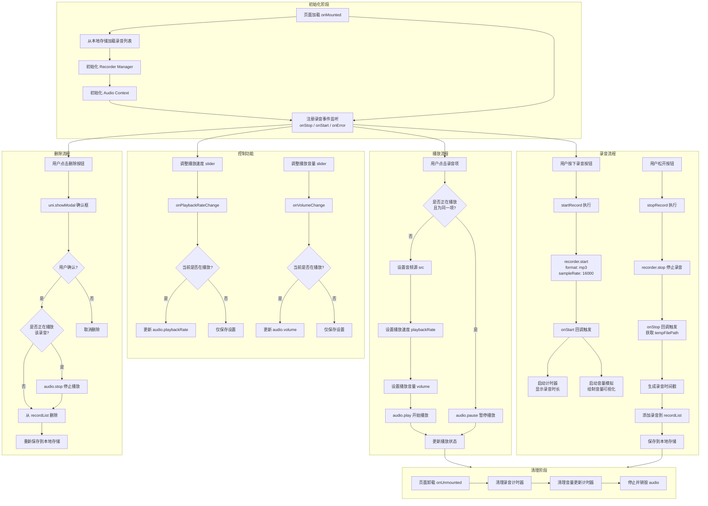

# 录音机项目流程框图

## 整体架构



## 模块说明

| 模块 | 描述 | 核心文件 |
|------|------|----------|
| 初始化阶段 | 页面加载时初始化录音管理器、音频上下文、加载历史记录 | record.vue:117-186 |
| 录音流程 | 长按开始录音，松开停止，保存到本地存储 | record.vue:212-252 |
| 播放流程 | 点击录音项进行播放/暂停，支持速度/音量调节 | record.vue:286-298 |
| 控制功能 | 播放速度和音量的实时调节 | record.vue:322-334 |
| 删除流程 | 带确认框的录音删除功能 | record.vue:300-320 |
| 清理阶段 | 页面卸载时释放资源 | record.vue:202-210 |

## 数据流向

```
用户操作 → 状态更新 → UI渲染 → 本地存储
```

录音文件存储路径: `tempFilePath` (临时文件)

录音列表存储: `uni.setStorageSync('recordList', recordList.value)`